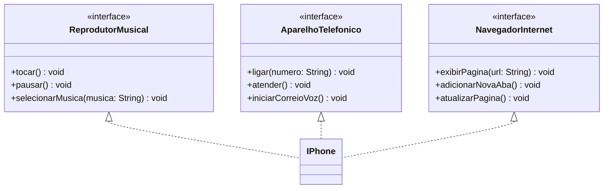

# iPhone em UML e Java: música, chamadas e internet

[](https://github.com/barbozadevti/java-iphone-uml/actions/workflows/ci.yml)

Entrega do desafio de projeto **"Modelando o iPhone com UML: Funções de Músicas, Chamadas e Internet"**, da [DIO](https://www.dio.me), sobre **análise de requisitos, orientação a objetos e modelagem UML**.

> Versão ampliada para portfólio: **[barbozadevti/tres-em-um](https://github.com/barbozadevti/tres-em-um)**, um iPhone que funciona no navegador (música tocando de verdade, teclado com tons DTMF, chamadas e Safari com abas), com o domínio em Java 21 + Spring Boot e o diagrama UML conferido por testes.

## O desafio

No lançamento de 2007, o iPhone foi apresentado como três aparelhos em um: **um iPod, um telefone e um navegador de internet**. A modelagem representa cada papel como uma **interface**, e o `IPhone` assume os três ao implementá-las.



O diagrama foi feito em **Mermaid** ([`diagrama/iphone.mmd`](diagrama/iphone.mmd)), que o GitHub desenha direto na página:



## Arquivos

| Arquivo | Papel |
|---|---|
| [`ReprodutorMusical.java`](src/ReprodutorMusical.java) | Interface: `tocar`, `pausar`, `selecionarMusica` |
| [`AparelhoTelefonico.java`](src/AparelhoTelefonico.java) | Interface: `ligar`, `atender`, `iniciarCorreioVoz` |
| [`NavegadorInternet.java`](src/NavegadorInternet.java) | Interface: `exibirPagina`, `adicionarNovaAba`, `atualizarPagina` |
| [`IPhone.java`](src/IPhone.java) | Implementa as três interfaces |
| [`Main.java`](src/Main.java) | Usa o mesmo iPhone por cada um dos três papéis |

## Conceitos aplicados

- **Interfaces como papéis:** quem só precisa tocar música recebe um `ReprodutorMusical`; não enxerga os métodos de telefone nem de navegador (princípio da segregação de interfaces).
- **Polimorfismo:** em `Main`, os métodos `usarComoReprodutor`, `usarComoTelefone` e `usarComoNavegador` recebem a interface, não a classe concreta.
- **Encapsulamento:** o estado (música atual, chamada em curso, abas) é privado e só muda pelos métodos.
- **Regras simples de negócio:** ao ligar ou atender, a música pausa; números inválidos e endereços vazios são recusados; endereços sem protocolo ganham `https://`.

## Como rodar

Requer o JDK 17 ou mais recente.

```bash
javac -encoding UTF-8 -d out src/*.java
java -cp out Main
```

```text
== Reprodutor musical ==
Música selecionada: Ode à Alegria - Beethoven
Tocando: Ode à Alegria - Beethoven

== Aparelho telefônico ==
Correio de voz: você não tem novas mensagens.
Pausado: Ode à Alegria - Beethoven
Ligando para 27998765432...
Chamada com 27998765432 encerrada.
Chamada recebida atendida.

== Navegador na internet ==
Exibindo página: https://www.dio.me (aba 1)
Nova aba aberta. Abas: 2
Exibindo página: https://github.com/barbozadevti (aba 2)
Atualizando: https://github.com/barbozadevti
```

## Testes

```bash
bash tests/testar.sh
```

Confere que o `IPhone` implementa as três interfaces e 15 comportamentos (incluindo casos de borda). Roda também no GitHub Actions a cada envio.
